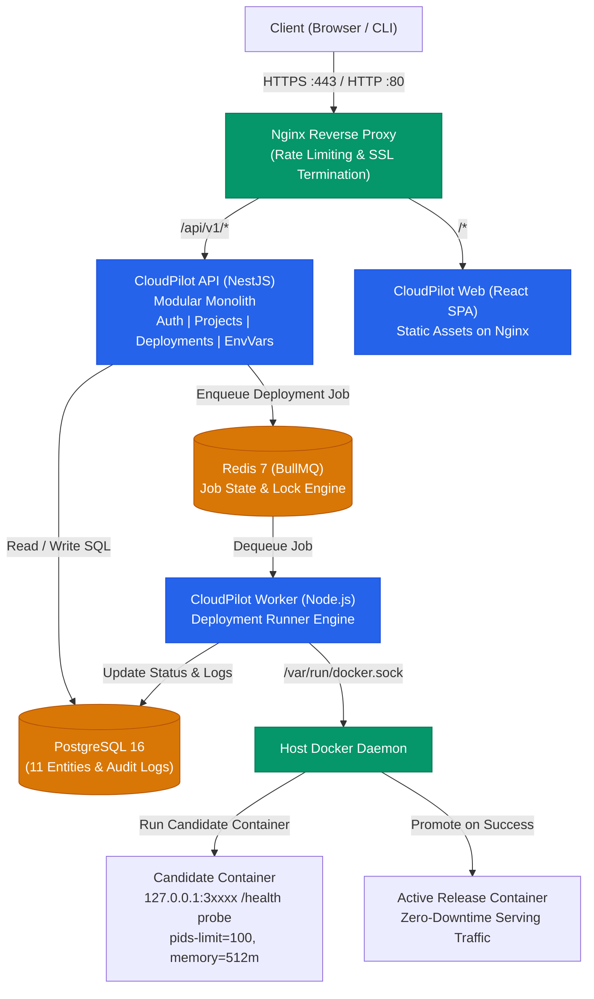
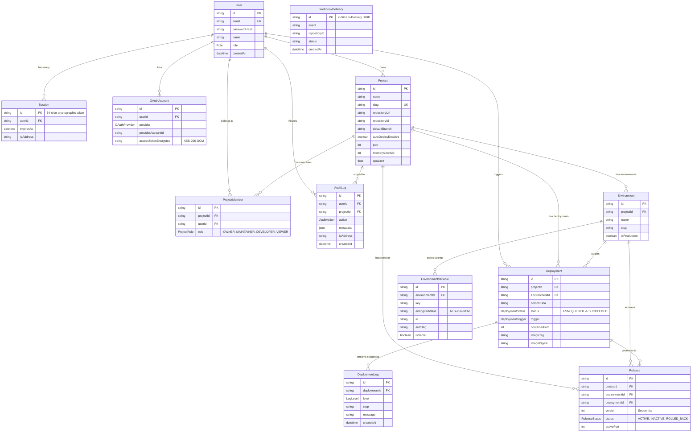

# CloudPilot

> **Automated Web Application Deployment & Management Platform**  
> _Nền tảng tự lưu trữ (Self-hosted PaaS) quản lý và tự động hóa triển khai ứng dụng web containerized từ Git repositories._

[](https://github.com/your-username/cloudpilot/actions/workflows/ci.yml)
[](https://www.typescriptlang.org/)
[](https://nestjs.com/)
[](https://react.dev/)
[](https://www.docker.com/)
[](https://www.postgresql.org/)
[](https://bullmq.io/)
[](LICENSE)

---

## 🎯 1. Bài toán giải quyết (Problem Statement)

Khi triển khai các ứng dụng web lên môi trường production:

- Các nền tảng thương mại (Vercel, Render, Heroku) tiện lợi nhưng chi phí tăng vọt khi mở rộng, giới hạn thời gian chạy và bị khóa chặt vào nhà cung cấp (vendor lock-in).
- Ngược lại, việc tự dựng Kubernetes hoặc các cụm máy chủ phân tán lại quá phức tạp, tốn tài nguyên và đòi hỏi chi phí bảo trì DevOps lớn đối với các đội ngũ vừa và nhỏ.

**CloudPilot** được xây dựng như một giải pháp **Self-hosted PaaS** tinh gọn nhưng chuẩn mực:

- **Tự động hóa hoàn toàn**: Kết nối Git, push code là tự động build Docker và deploy.
- **Bảo vệ toàn diện**: Cô lập container (`--pids-limit=100`, memory/cpu cgroup, non-root, `127.0.0.1` binding), ngăn chặn command injection, SSRF và BOLA/IDOR.
- **Zero-Downtime & Rollback tức thì**: Cơ chế Blue-Green release kiểm tra health check trước khi switch traffic, tái triển khai release cũ trong 3 giây mà không cần build lại.
- **Mã hóa bí mật**: Biến môi trường và GitHub token được mã hóa an toàn bằng **AES-256-GCM** kèm audit logging.

---

## 🌟 2. Tính năng cốt lõi (Key Features)

- **Authentication & RBAC**: Session-based auth với cookie `HttpOnly`, hash mật khẩu bằng `Argon2id`, phân quyền 4 cấp độ trên từng dự án (`OWNER`, `MAINTAINER`, `DEVELOPER`, `VIEWER`).
- **GitHub Integration**: Kết nối OAuth tối giản quyền (`read:user`, `repo`), xác minh webhook HMAC-SHA256, chống replay attack với delivery UUID, tự động deploy theo branch cấu hình.
- **Deterministic Deployment FSM Engine**: Quản lý vòng đời triển khai qua Finite State Machine (`QUEUED` $\to$ `CLONING` $\to$ `BUILDING` $\to$ `DEPLOYING` $\to$ `HEALTH_CHECKING` $\to$ `SUCCEEDED`).
- **Asynchronous Queue & Worker**: Tách biệt NestJS API và BullMQ Worker qua Redis, đảm bảo API phản hồi tức thì (<15ms) và worker xử lý build nền ổn định.
- **Container Hardening**: Giới hạn 512MB RAM, 0.5 CPU, 100 process (chống fork bomb), không bao giờ mount Docker socket vào ứng dụng của người dùng.
- **Zero-Downtime Blue-Green Release**: Chủ động thăm dò endpoint `/health` trên port ứng dụng mới trước khi chuyển traffic; giữ nguyên phiên bản cũ nếu bản mới gặp lỗi.
- **1-Click Rollback**: Tái triển khai image digest đã được kiểm chứng của release cũ trong vài giây mà không cần git clone hay docker build lại.
- **Encrypted Environment Variables**: Lưu trữ bản mã hóa AES-256-GCM trong PostgreSQL, che giá trị (`••••••••`) trên API danh sách, chỉ giải mã khi deploy hoặc khi Owner/Maintainer xem qua endpoint có ghi Audit Log.
- **Observability & SRE**: Gắn `X-Request-Id` correlation ID xuyên suốt hệ thống, structured HTTP logging, endpoint `/api/v1/health` và `/api/v1/health/detailed` đo lường độ trễ DB/Redis và tải hàng đợi.
- **Disaster Recovery**: Tiện ích sao lưu và khôi phục database nguyên tử (`pnpm db:backup` / `pnpm db:restore`) trong một `$transaction` duy nhất.

---

## 🛠️ 3. Công nghệ sử dụng (Tech Stack)

| Lớp kiến trúc         | Công nghệ                   | Lý do lựa chọn                                                                      |
| :-------------------- | :-------------------------- | :---------------------------------------------------------------------------------- |
| **Monorepo Manager**  | `pnpm` workspaces (v12)     | Cài đặt dependencies cực nhanh với hard links, quản lý monorepo đa gói an toàn      |
| **Backend API**       | NestJS v11, TypeScript      | Kiến trúc Modular Monolith chuẩn mực, Dependency Injection, Guards, Interceptors    |
| **Deployment Worker** | Node.js, BullMQ, Docker SDK | Tách biệt worker tiến trình nền, hàng đợi Redis chống nghẽn API, tự động retry      |
| **Database & ORM**    | PostgreSQL 16, Prisma v6    | Hệ quản trị CSDL quan hệ chuẩn ACID, Prisma type-safe schema và migration mạnh mẽ   |
| **Queue & Cache**     | Redis 7, BullMQ             | Hàng đợi tin cậy, hỗ trợ job stalled detection, exponential backoff và concurrency  |
| **Frontend UI**       | React 19, TypeScript, Vite  | Tốc độ build vượt trội, Tailwind CSS tinh gọn, quản lý state và routing kiểm soát   |
| **Reverse Proxy**     | Nginx Alpine, OpenSSL       | TLS 1.3 termination, rate limiting, HSTS, security headers, reverse proxy `/api/v1` |
| **Container Engine**  | Docker, Docker Compose      | Đóng gói môi trường chuẩn staging/production, cgroup resource limits                |
| **Testing**           | Vitest, Supertest           | 76 test suites chạy siêu tốc, kiểm thử toàn diện từ Unit, Integration đến E2E       |
| **CI/CD**             | GitHub Actions              | Tự động hóa format check, lint, typecheck, test, build và publish Docker images     |

---

## 🏗️ 4. Sơ đồ kiến trúc hệ thống (System Architecture)



---

## 🗄️ 5. Mô hình dữ liệu (Entity Relationship Diagram - ERD)



---

## 🔄 6. Deployment Finite State Machine (FSM)

```
[QUEUED] ──► [CLONING] ──► [BUILDING] ──► [DEPLOYING] ──► [HEALTH_CHECKING] ──► [SUCCEEDED]
   │             │              │              │                 │
   └─────────────┴──────────────┴──────────────┴─────────────────┴──► [FAILED / CANCELLED / TIMED_OUT]
```

- **`QUEUED`**: API xác thực quyền project, giải mã biến môi trường, ghi nhận deployment và đẩy job vào BullMQ (<15ms).
- **`CLONING`**: Worker nhận job, kiểm tra format commit SHA và clone repository bằng direct process spawn không qua shell.
- **`BUILDING`**: Build Docker image với tag duy nhất `cloudpilot/<slug>:<env>-<shortSha>-<shortDepId>`.
- **`DEPLOYING`**: Cấp phát dynamic port (`127.0.0.1:3xxxx`), khởi chạy container với cgroups giới hạn `--memory=512m`, `--cpus=0.5` và `--pids-limit=100`.
- **`HEALTH_CHECKING`**: Thăm dò `http://127.0.0.1:<port>/health` mỗi giây (tối đa 30s timeout).
- **`SUCCEEDED`**: Health check thành công, candidate container được thăng hạng thành `ACTIVE Release`, container cũ giải phóng an toàn (Zero Downtime).
- **`CANCELLED` / `FAILED`**: Nếu gặp lỗi hoặc bị hủy, candidate container lập tức bị dọn dẹp; phiên bản đang chạy cũ vẫn hoạt động 100% bình thường.

---

## 📡 7. Danh mục API Endpoints (`/api/v1`)

| Method   | Endpoint                                                | Quyền hạn                   | Mô tả                                                           |
| :------- | :------------------------------------------------------ | :-------------------------- | :-------------------------------------------------------------- |
| `POST`   | `/auth/register`                                        | Public (Rate-limited: 5/m)  | Đăng ký tài khoản mới, hash Argon2id, cấp Session cookie        |
| `POST`   | `/auth/login`                                           | Public (Rate-limited: 5/m)  | Đăng nhập hệ thống, trả về cookie HttpOnly `cloudpilot_session` |
| `POST`   | `/auth/logout`                                          | Authenticated               | Thu hồi phiên đăng nhập và xóa cookie                           |
| `GET`    | `/auth/me`                                              | Authenticated               | Lấy thông tin tài khoản đang đăng nhập                          |
| `GET`    | `/health`                                               | Public                      | Kiểm tra kết nối và độ trễ Database & Redis, bộ nhớ Node        |
| `GET`    | `/health/detailed`                                      | Public                      | Trả về thống kê hàng đợi BullMQ (waiting, active, completed)    |
| `POST`   | `/projects`                                             | Authenticated               | Tạo project mới, tự động cấp quyền `OWNER`                      |
| `GET`    | `/projects`                                             | Authenticated               | Lấy danh sách project người dùng là thành viên                  |
| `GET`    | `/projects/:id`                                         | Project Member              | Lấy chi tiết project và danh sách environments                  |
| `DELETE` | `/projects/:id`                                         | Project OWNER               | Xóa project và cascade dọn dẹp tài nguyên                       |
| `GET`    | `/projects/:id/environments/:envId/variables`           | Project Member              | Lấy danh sách biến môi trường (Secrets được che `••••••••`)     |
| `POST`   | `/projects/:id/environments/:envId/variables`           | OWNER / MAINTAINER          | Thêm/sửa biến môi trường mã hóa AES-256-GCM                     |
| `POST`   | `/projects/:id/environments/:envId/variables/:k/reveal` | OWNER / MAINTAINER          | Giải mã xem giá trị secret (Tạo sự kiện `AuditLog`)             |
| `POST`   | `/deployments`                                          | Project Member (Rate: 10/m) | Kích hoạt deployment thủ công cho project                       |
| `GET`    | `/deployments`                                          | Project Member              | Lấy lịch sử deployments hỗ trợ phân trang `page` & `limit`      |
| `GET`    | `/deployments/:id`                                      | Project Member              | Lấy trạng thái chi tiết, port container và metadata             |
| `GET`    | `/deployments/:id/logs`                                 | Project Member              | Lấy sequential logs theo trình tự thời gian                     |
| `POST`   | `/deployments/:id/cancel`                               | OWNER / Initiator           | Hủy tiến trình deployment đang chạy                             |
| `POST`   | `/deployments/:id/rollback`                             | OWNER / MAINTAINER          | Rollback tức thì về release trước đó (Zero Downtime)            |
| `GET`    | `/github/connect`                                       | Authenticated               | Lấy URL ủy quyền GitHub OAuth kèm CSRF state token              |
| `GET`    | `/github/callback`                                      | Authenticated               | Trao đổi token GitHub, mã hóa AES-256-GCM và liên kết           |
| `GET`    | `/github/repositories`                                  | Authenticated               | Lấy danh sách repositories GitHub được phép truy cập            |
| `POST`   | `/github/webhooks`                                      | GitHub Webhook              | Tiếp nhận webhook, xác thực HMAC-SHA256, auto-deploy            |

---

## ⚡ 8. Hướng dẫn cài đặt và chạy Local (Quickstart)

### Yêu cầu hệ thống:

- **Node.js**: `>= 20.0.0` (Khuyến nghị: `v22` hoặc `v24`)
- **pnpm**: `>= 10.0.0` (Khuyến nghị: `v12.6.0`)
- **Docker & Docker Compose**: Đã cài đặt và đang chạy

### Bước 1: Clone repository và cài dependencies

```bash
git clone https://github.com/your-username/cloudpilot.git
cd cloudpilot
pnpm install
```

### Bước 2: Cấu hình biến môi trường

```bash
cp .env.example .env
```

_(File `.env.example` đã cấu hình sẵn khóa mã hóa 64 ký tự `ENCRYPTION_MASTER_KEY` và các cấu hình mặc định để chạy ngay)._

### Bước 3: Khởi động cơ sở hạ tầng (PostgreSQL & Redis)

```bash
pnpm dev:infra
```

### Bước 4: Khởi tạo database và seed dữ liệu demo

```bash
pnpm db:generate
pnpm db:push
pnpm db:seed
```

### Bước 5: Khởi động các dịch vụ

Mở 3 terminal riêng biệt hoặc dùng background processes:

```bash
# Terminal 1: NestJS API (:4000)
pnpm api:dev

# Terminal 2: BullMQ Deployment Worker
pnpm worker:dev

# Terminal 3: React Vite Dashboard (:3000)
pnpm web:dev
```

Truy cập Dashboard tại: **`http://localhost:3000`**

### Tài khoản Demo an toàn (Seed data):

- **Admin**: `admin@cloudpilot.local` / `Admin123!@#`
- **Developer**: `dev@cloudpilot.local` / `Dev123!@#`

---

## 🐳 9. Triển khai môi trường Staging (Docker Compose + Nginx)

CloudPilot đi kèm cấu hình hoàn chỉnh để chạy toàn bộ stack trên môi trường staging độc lập qua Docker Compose:

```bash
# 1. Tạo chứng chỉ SSL tự ký cho Staging HTTPS
pnpm certs:generate

# 2. Khởi chạy toàn bộ 6 container (Postgres, Redis, API, Worker, Web, Nginx)
pnpm staging:up

# 3. Chạy kiểm thử tự động Smoke Test
pnpm test:smoke

# 4. Khi cần tắt môi trường staging
pnpm staging:down
```

---

## 🧪 10. Kiểm thử tự động (Automated Testing)

CloudPilot tích hợp quy trình kiểm thử nghiêm ngặt đạt **100% tỷ lệ pass trên 76 test suites**:

```bash
# Chạy toàn bộ test suites (Shared, Database, Worker, API & Supertest E2E)
pnpm test

# Chạy kiểm tra định dạng Prettier
pnpm format:check

# Chạy kiểm tra linter ESLint
pnpm lint

# Chạy kiểm tra kiểu tĩnh TypeScript
pnpm typecheck

# Build toàn bộ các packages và ứng dụng
pnpm build
```

---

## 📚 11. Tài liệu kỹ thuật chuyên sâu (Documentation)

- [**SECURITY.md**](SECURITY.md) — Mô hình đe dọa STRIDE, Security Checklist, phân tích rủi ro an ninh và các giới hạn kiến trúc tồn đọng.
- [**docs/ARCHITECTURE.md**](docs/ARCHITECTURE.md) — 6 Architecture Decision Records (ADRs) chi tiết về Modular Monolith, BullMQ, FSM Engine, Container Isolation, Blue-Green Rollback và AES-256-GCM.
- [**docs/RUNBOOK.md**](docs/RUNBOOK.md) — Cẩm nang vận hành SRE: Quy trình Backup, Restore, Rollback và 5 kịch bản xử lý sự cố thực tế (Incident Response Playbook).
- [**docs/INTERVIEW_QA.md**](docs/INTERVIEW_QA.md) — Bộ 10 câu hỏi phỏng vấn kỹ thuật Full-stack & DevOps chuyên sâu kèm câu trả lời dựa trên mã nguồn CloudPilot.
- [**docs/DEMO_WALKTHROUGH.md**](docs/DEMO_WALKTHROUGH.md) — Kịch bản phân cảnh (Storyboard) và hướng dẫn quay video demo 5 phút.

---

## ⚖️ 12. Giấy phép (License)

Dự án được phân phối dưới giấy phép **MIT License**.
